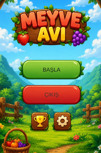
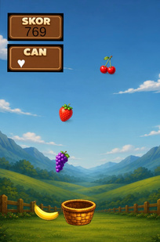
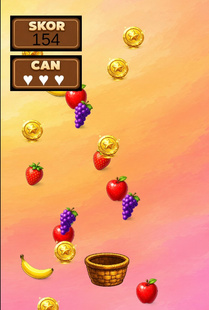
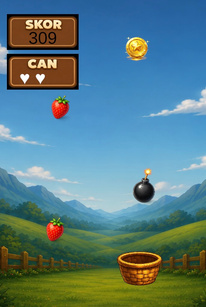
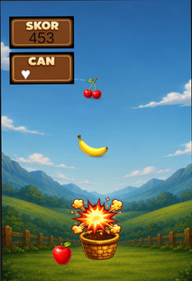
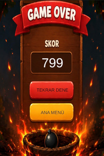

# Meyve Avı — Unity 2D Oyun

Meyve Avı, Unity ve C# ile geliştirilmiş 2D bir yakalama oyunudur. Oyuncu ekranın altındaki sepeti sağa sola hareket ettirerek gökten düşen meyveleri yakalar. Yakalanan meyveler puan kazandırır, bombalar ise can kaybettirir. Altın paralar ve Bonus Mode oyuna ekstra heyecan katar.

## Özellikler

- **Sepet kontrolü:** Sepeti klavyeyle (← → ya da A / D) sağa sola hareket ettirme
- **Meyve yakalama:** Elma, çilek, üzüm, muz, kiraz gibi düşen meyveleri yakalayarak puan toplama
- **Bomba engeli:** Bombaya temas edildiğinde patlama efekti ve can kaybı
- **Can ve skor sistemi:** Ekranda anlık skor ve kalan can göstergesi
- **Golden Coin:** Ekstra puan kazandıran altın paralar
- **Bonus Mode:** Altın paraların yağdığı, arka planın değiştiği özel oyun modu
- **Arka plan geçiş efektleri:** Normal mod ile Bonus Mode arasında arka plan geçişi
- Ana menü ve Game Over ekranı (Tekrar Dene / Ana Menü)

## Ekran Görüntüleri

| Ana Menü | Normal Oyun | Bonus Mode |
|:---:|:---:|:---:|
|  |  |  |

| Bomba | Bomba Patlama | Game Over |
|:---:|:---:|:---:|
|  |  |  |

## Kullanılan Teknolojiler

- **Unity 6** (6000.4.0f1)
- **C#**
- Universal Render Pipeline (URP)
- TextMesh Pro

## Proje Yapısı

```
Assets/
├── Scenes/      # MainScene
├── Scripts/     # Oyun mantığı
├── Prefabs/     # Meyve, bomba, altın meyve ve patlama prefab'ları
└── Sprites/     # Oyun görselleri
```

| Script | Görevi |
|---|---|
| `BasketController.cs` | Sepet hareketi |
| `BasketCatch.cs` | Meyve, bomba ve altın para yakalama |
| `FruitSpawner.cs` / `FruitFall.cs` | Nesnelerin oluşturulması ve düşmesi |
| `ScoreManager.cs` | Skor sistemi |
| `LifeManager.cs` | Can sistemi ve Game Over |
| `BonusModeManager.cs` | Bonus Mode |
| `BackgroundManager.cs` | Arka plan geçişleri |
| `MenuController.cs` | Menü ve sahne geçişleri |
| `DestroyAfterTime.cs` | Efektlerin süre sonunda silinmesi |

## Çalıştırma

1. Depoyu klonlayın: `git clone https://github.com/livzaaa/MeyveAvi.git`
2. Unity Hub'da **Add → Add project from disk** ile klasörü açın (Unity 6000.4.0f1 önerilir).
3. `Assets/Scenes/MainScene` sahnesini açıp **Play**'e basın.

## Geliştirici

Livza Balkan — Oyun Programlama dersi projesi
